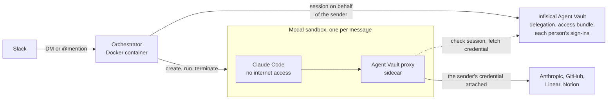

# Team assistant

A Slack assistant for your whole team. DM it or mention it in a channel, and it does the work with the access of the person who asked: their GitHub, their Linear, their Notion.

Each message runs Claude Code in a fresh [Modal](https://modal.com/docs/guide/sandboxes) sandbox that holds no credentials and can't reach the internet. Its only way out is an [Infisical Agent Vault](https://infisical.com/docs/documentation/platform/agent-vault/overview) proxy running beside it in the same sandbox. The proxy attaches the credentials of the person who asked, and blocks requests to any host outside the access bundle.

## How it works



1. Someone DMs the bot or mentions it in a channel. The orchestrator looks up the email on their Slack profile.
2. The orchestrator logs in as its machine identity and starts an Agent Vault [session on behalf of](https://infisical.com/docs/documentation/platform/agent-vault/sessions-on-behalf-of-users) the Infisical user with that email, over the `team-assistant` access bundle. If the identity's delegation doesn't cover them, the bot says so and starts nothing.
3. It creates a Modal sandbox with no public egress, and starts the Agent Vault proxy in it as a sidecar. The agent's container can reach only the sidecar.
4. It runs Claude Code in the sandbox, behind the sidecar, with the session token on stdin. The proxy attaches the person's own sign-ins, so the agent sees what they can see in each tool, and nothing else.
5. The bot posts what Claude Code is doing as a status line in Slack, then posts the answer in the thread. The orchestrator revokes the session and terminates the sandbox.

The orchestrator follows the [Agent Vault guide for Modal](https://infisical.com/docs/documentation/platform/agent-vault/guides/modal): it starts sessions with the [Infisical Node.js SDK](https://infisical.com/docs/sdks/languages/node), and each sandbox runs the proxy as a sidecar from the same image as the agent.

The sandbox holds no credentials. The orchestrator holds real ones: the Slack tokens, the Modal token, and the machine identity's client secret, which it needs to start sessions. Keep it on a host of its own.

## What's in this folder

| File | What it does |
| --- | --- |
| `prompt.md` | The agent's instructions, added to Claude Code's system prompt |
| `mcp.json` | The MCP servers every run gets, by URL and with no credentials |
| `.env.example` | The orchestrator's settings |
| `slack-app-manifest.yaml` | The Slack app |
| `src/` | The orchestrator: reads Slack, starts sessions, and runs each message in a sandbox |
| `src/smoke.ts` | Checks Modal and Agent Vault without Slack |
| `Dockerfile`, `docker/` | The orchestrator's image, a Compose file, and the template for its secret file |

Claude Code runs in `bypassPermissions` mode with a shell, so it can run any command in its sandbox without asking. The sandbox is the boundary: it's new for every message, and it's terminated when the answer is posted.

## Agent Vault configuration

**Access bundle:** `team-assistant`, with these services:

| Service | Template | Server or hosts | Credential |
| --- | --- | --- | --- |
| Anthropic | Anthropic | `api.anthropic.com` | An Anthropic API key |
| GitHub MCP | GitHub MCP | `https://api.githubcopilot.com/mcp/` | OAuth, member provided, with your own OAuth app |
| Linear MCP | Linear MCP | `https://mcp.linear.app/mcp` | OAuth, member provided |
| Notion MCP | Notion MCP | `https://mcp.notion.com/mcp` | OAuth, member provided |

You don't need all three MCP servers. Add the ones your team uses, and keep `mcp.json` the same list.

**Machine identity:** `team-assistant`, with the Member role in Agent Vault, access to the `team-assistant` access bundle, and a [delegation](https://infisical.com/docs/documentation/platform/agent-vault/sessions-on-behalf-of-users#set-up-a-delegation) that covers the people who can use the assistant.

**Proxy:** one proxy with the **Service hosts only** traffic policy. Every sandbox runs a copy of it as a sidecar.

**People:** each person who uses the assistant is a member of the Agent Vault project, with a grant on the access bundle, and connects their own account to each MCP service. The email on their Slack profile must be the email of their Infisical account.

A session on someone's behalf reaches only the access bundles that both the machine identity and the person can use, and uses the person's own sign-ins. Anyone with the identity's client secret can act as anyone in the delegation, so keep the delegation to the people who use the assistant, and the client secret on the orchestrator's host only.

## What you need

**Accounts and tools:**

- An Infisical organization with Agent Vault, and the Admin role in an Agent Vault project
- A Slack workspace where you can create apps
- A Modal workspace
- A host for the orchestrator that runs Docker containers, such as a small VM or Render. It needs outbound internet access only. Claude Code runs in Modal, not on this host

**Credentials.** Each one goes into Agent Vault, never into a file:

| Credential | Where to get it | Where it goes |
| --- | --- | --- |
| Anthropic API key | The Anthropic Console | The Anthropic service |
| Each person's GitHub, Linear, and Notion sign-ins | Each person connects their own, in [Step 5](#step-5-give-people-access) | Their personal values for each MCP service |

**Secrets for the orchestrator.** Each one goes into `docker/team-assistant.env`, never into git:

| Secret | Where to get it |
| --- | --- |
| Proxy token | The **Proxy Token** dialog, in [Step 2](#step-2-create-the-proxy) |
| Machine identity client ID and client secret | The machine identity, in [Step 4](#step-4-create-the-machine-identity) |
| Modal token ID and secret | [modal.com/settings/tokens](https://modal.com/settings/tokens). Use a token for a service user, not a person's |
| Slack bot token (`xoxb-...`) and app-level token (`xapp-...`) | The Slack app, in [Step 1](#step-1-create-the-slack-app) |

**Settings that aren't secret.** They go into `.env`:

| Setting | Where to get it |
| --- | --- |
| `INFISICAL_AGENT_VAULT_PROJECT_ID` | The Agent Vault project's URL, after `/projects/agent-vault/` |
| `INFISICAL_AGENT_VAULT_CA_FINGERPRINT` | The **Certificate Authority** column on the **Proxies** page, in [Step 2](#step-2-create-the-proxy) |

## Step 1: Create the Slack app

1. Go to [api.slack.com/apps](https://api.slack.com/apps) and select **Create New App** > **From a manifest**.
2. Paste [`slack-app-manifest.yaml`](slack-app-manifest.yaml) and select **Create**.
3. Install the app to your workspace, then copy the **Bot User OAuth Token** (`xoxb-...`) from **OAuth & Permissions**.
4. In **Basic Information** > **App-Level Tokens**, create a token with the `connections:write` scope and copy it (`xapp-...`).

The app uses Socket Mode, so the orchestrator doesn't need a public URL. People can DM the bot, and mention it in any channel they invite it to.

## Step 2: Create the proxy

1. In Agent Vault, go to **Proxies** and select **Create Proxy**.
2. Enter a **Name**, expand **Advanced Options**, and set **Traffic Policy** to **Service hosts only**.
3. Select **Create**, and keep the proxy token from the **Proxy Token** dialog. Rotating the token later also changes the proxy's fingerprint, so update `.env` when you do.
4. Copy the proxy's fingerprint from the **Certificate Authority** column on the **Proxies** page. Each sandbox checks it before the agent starts.

## Step 3: Create the access bundle

1. Go to **Access Bundles** and select **Create Access Bundle**. Name it `team-assistant`.
2. Open the access bundle and select **Add Service**. Add the Anthropic service from its template, and paste the API key.

Add each MCP server your team uses. The proxy attaches each person's own sign-in, so the agent acts as them:

1. Add a service from the server's template, such as **Linear MCP**.
2. On the **Credential** step, keep **OAuth** as the credential type, and turn on **Member provided**.

GitHub's MCP server doesn't let Infisical register as an OAuth client, so its service needs [your own OAuth app](https://infisical.com/docs/documentation/platform/agent-vault/mcp-servers#use-your-own-oauth-app).

## Step 4: Create the machine identity

1. Create a [machine identity](https://infisical.com/docs/documentation/platform/identities/machine-identities) named `team-assistant` with Universal Auth, and create a client secret for it.
2. In Agent Vault, go to **Access Control** > **Machine Identities** and select **Add Machine Identity**. Select the identity and choose **Member** in **Product Role**.
3. Open the `team-assistant` access bundle, select **Manage Access**, and select **Grant Access** next to the identity.
4. On the machine identity's page, in the **Delegation** section, select **Manage Delegation**. Add the users or groups who can use the assistant.

## Step 5: Give people access

Each person who uses the assistant needs:

1. Membership in the Agent Vault project, with the same email as their Slack profile.
2. A grant on the `team-assistant` access bundle. Admins of the project already have one.
3. Their own sign-in for each MCP service. In the Agent Vault project, they go to **Services**, select **Requires Setup** next to each service, select **Connect Account**, and approve access in the pop-up window.

The agent can use a service only after the person connects it. Until then, it tells them to connect it in Agent Vault.

## Step 6: Deploy the orchestrator

1. In this folder, copy `.env.example` to `.env`, and fill in the settings from [What you need](#what-you-need).

2. Copy the template for the secret file, and keep the copy out of git:

   ```
   cp docker/team-assistant.env.example docker/team-assistant.env
   ```

3. Fill in `docker/team-assistant.env` with the proxy token, the machine identity's client ID and client secret, the Modal token, and the Slack tokens. If you use Infisical outside US Cloud, add `INFISICAL_DOMAIN` to `.env`, such as `https://eu.infisical.com`.

4. Check Modal and Agent Vault without Slack. The first check starts a sandbox and its proxy, and checks that the agent can reach only the proxy. The second runs the agent once on behalf of a person in the delegation, and needs their account connected to at least one MCP service:

   ```
   cd docker
   docker compose run --rm --build orchestrator node src/smoke.ts --preflight
   docker compose run --rm orchestrator node src/smoke.ts --as you@example.com "Which Linear account are you connected as?"
   ```

5. Start the orchestrator:

   ```
   docker compose up -d --build
   ```

6. DM the bot, and ask it something that needs one of your tools, such as the issues assigned to you in Linear.

To run the same image on a container host such as Render, set the variables from `.env` and `docker/team-assistant.env` on the service. Run one orchestrator per Slack app: Slack splits events between the connections of an app.

## Replies that don't mention the bot

By default, the bot answers only DMs and mentions. To have it answer a reply in a thread it's already in without being mentioned, add an Anthropic API key as `ANTHROPIC_API_KEY` in `docker/team-assistant.env`. The orchestrator asks `claude-haiku-5-5` whether each such reply is meant for the bot, and runs the agent unless it's clearly not. The key is the orchestrator's own: it isn't behind Agent Vault.

In a thread, people can ask the bot to stop following it. It then ignores untagged replies there until someone mentions it.

## Limits

- The email on each person's Slack profile must match their Infisical account. Someone whose emails differ gets a reply that the bot can't act for them
- The orchestrator holds real secrets, and isn't behind Agent Vault. Keep it on a host of its own
- Sidecars are a Modal beta feature (`experimentalSidecars` in Modal's JavaScript SDK), so the API may change
- Modal allows DNS lookups from a sandbox even with no public egress
- Every sandbox's sidecar holds the proxy token. The sidecar is a separate container from the agent's
- Messages from other people in a thread go to the agent as context, marked as not instructions. The agent acts with the requester's access, and nothing but its instructions stops it from following them
- The agent has no memory between messages. Within a thread, it reads the earlier messages each time
- Threads the bot was asked to stop following are kept in memory, so a restart forgets them
