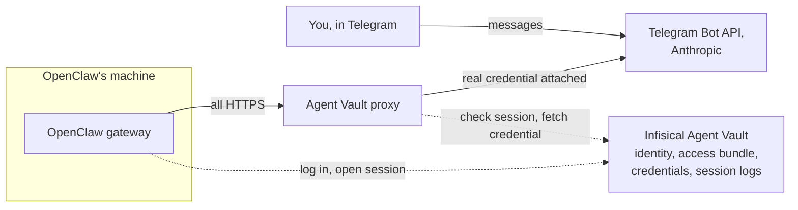

# OpenClaw on Telegram

A personal [OpenClaw](https://docs.openclaw.ai/) assistant that you message on Telegram, running on a machine of its own.

OpenClaw holds no real API keys. [Infisical Agent Vault](https://infisical.com/docs/documentation/platform/agent-vault/overview) attaches each credential to OpenClaw's requests on their way out, and blocks requests to any host outside its access bundle.

## How it works

1. `infisical agent-vault run` logs in as OpenClaw's machine identity, opens a [session](https://infisical.com/docs/documentation/platform/agent-vault/sessions) on the `openclaw` [access bundle](https://infisical.com/docs/documentation/platform/agent-vault/access-bundles), and starts `openclaw gateway run` behind the Agent Vault [proxy](https://infisical.com/docs/documentation/platform/agent-vault/proxies).
2. `agent-vault run` sets `OPENCLAW_PROXY_URL`, so the gateway sends all of its traffic through the proxy, including its Telegram client and the commands OpenClaw runs.
3. The gateway polls Telegram for your messages and sends them to Anthropic. The proxy replaces the Telegram placeholder in each request's URL with the real bot token, and attaches the Anthropic key.
4. If the host is in the access bundle, the proxy attaches the real credential. If it isn't, the proxy returns a 403.

OpenClaw's environment has only placeholders: `ANTHROPIC_API_KEY=agent-vault` and `TELEGRAM_BOT_TOKEN=avplaceholder-openclaw-telegram`.

## What's in this folder

| File | What it does |
| --- | --- |
| `openclaw.json` | OpenClaw's config: the model, and Telegram with an allowlist of who can message it |
| `digitalocean/` | The gateway and the proxy as systemd services on a DigitalOcean Droplet, or any Ubuntu server |

OpenClaw can run commands on its machine. Run it on a machine of its own.

## Agent Vault configuration

**Access bundle:** `openclaw`, with these services:

| Service | Template | Hosts | Credential |
| --- | --- | --- | --- |
| Anthropic | Anthropic | `api.anthropic.com` | An Anthropic API key |
| Telegram | Custom HTTP API | `api.telegram.org` | Pass-through, with a URL path [substitution](https://infisical.com/docs/documentation/platform/agent-vault/http-apis#substitutions) for the bot token |

**Machine identity:** `openclaw`, with the Member role in Agent Vault and access to the `openclaw` access bundle only.

**Proxy:** one proxy with the **Service hosts only** traffic policy.

To give OpenClaw another API, such as GitHub, add a service for it to the access bundle. If OpenClaw refuses to use the API without a key, give it a placeholder in its environment.

The machine identity's client secret is on OpenClaw's machine, so OpenClaw can read it and open more sessions. That's by design. A Member can only open sessions on the access bundles it's granted, so a session OpenClaw opens for itself reaches nothing the first one didn't. Two consequences:

- Grant the identity this one access bundle only, and keep its role at Member
- Revoking OpenClaw's session doesn't stop it, because it can open another one. To stop OpenClaw, revoke the client secret

To limit where a leaked client secret works, restrict it to OpenClaw's machine with [trusted IPs](https://infisical.com/docs/documentation/platform/identities/universal-auth), and give it an expiry.

## What you need

**Accounts:**

- An Infisical organization with Agent Vault, and the Admin role in an Agent Vault project
- A Telegram account

**Credentials.** Each one goes into Agent Vault, never into a file or OpenClaw's environment:

| Credential | Where to get it | Where it goes |
| --- | --- | --- |
| Anthropic API key | The Anthropic Console | The Anthropic service |
| Telegram bot token | [Step 1](#step-1-create-the-telegram-bot) | The Telegram service's substitution |

**Secrets for running OpenClaw.** Each one goes into the deployment's secret file, never into git:

| Secret | Where to get it |
| --- | --- |
| Proxy token | The **Proxy Token** dialog, in [Step 2](#step-2-create-the-proxy) |
| Machine identity client ID and client secret | The machine identity, in [Step 4](#step-4-create-the-machine-identity) |

You also need the Agent Vault project's ID and the proxy's fingerprint, which aren't secret. The deployment's secret file holds them, next to the secrets.

**Settings that aren't secret.** They go into `openclaw.json`:

| Setting | Where to get it |
| --- | --- |
| `channels.telegram.allowFrom` | Your numeric Telegram user ID, from [Step 1](#step-1-create-the-telegram-bot) |

## Step 1: Create the Telegram bot

1. In Telegram, message [@BotFather](https://t.me/BotFather), send `/newbot`, and follow the prompts. Copy the bot token it sends you.
2. Find your numeric user ID, for example by messaging [@userinfobot](https://t.me/userinfobot).
3. In `openclaw.json`, replace `<your-telegram-user-id>` with your user ID. Only the IDs in `allowFrom` can message OpenClaw.

## Step 2: Create the proxy

1. In Agent Vault, go to **Proxies** and select **Create Proxy**.
2. Enter a **Name**, expand **Advanced Options**, and set **Traffic Policy** to **Service hosts only**. With **Any host**, the proxy forwards requests to hosts outside the access bundle instead of blocking them.
3. Select **Create**, and keep the proxy token from the **Proxy Token** dialog. You can rotate it later from the proxy's menu. Rotating it also changes the proxy's fingerprint, so update the fingerprint wherever OpenClaw runs.
4. Copy the proxy's fingerprint from the **Certificate Authority** column on the **Proxies** page. OpenClaw's machine uses it to check that it's talking to your proxy.

## Step 3: Create the access bundle

1. Go to **Access Bundles** and select **Create Access Bundle**. Name it `openclaw`.
2. Open the access bundle and select **Add Service**. Add the Anthropic service from its template, and paste the API key.

Telegram puts the bot token in the URL of each request, such as `https://api.telegram.org/bot<token>/getUpdates`, so the Telegram service uses a substitution:

1. Add a service with the **Custom HTTP API** template, and enter `api.telegram.org` in **Hosts**.
2. On the **Credential** step, set the credential type to **Pass-through**.
3. Expand **Advanced Options** and select **Add Substitution**. Enter `avplaceholder-openclaw-telegram` in **Replace**, enter the bot token in **With**, and select **URL Path** under **Replace In**.

## Step 4: Create the machine identity

1. Create a [machine identity](https://infisical.com/docs/documentation/platform/identities/machine-identities) named `openclaw` with Universal Auth, and create a client secret for it.
2. In Agent Vault, go to **Access Control** > **Machine Identities** and select **Add Machine Identity**. Select the identity and choose **Member** in **Product Role**.
3. Open the `openclaw` access bundle, select **Manage Access**, and select **Grant Access** next to the identity.

Keep the client ID and client secret. The client secret is the only real secret OpenClaw's machine holds.

## Step 5: Deploy to DigitalOcean

Follow [`digitalocean/`](digitalocean) to run the gateway and the proxy as systemd services on a Droplet, then message your bot on Telegram.

## Limits

- The proxy can't carry WebSocket connections, so a channel that connects over a WebSocket, such as Discord, doesn't work through Agent Vault. Telegram's Bot API is plain HTTPS
- With a shell, OpenClaw can send requests that skip the proxy. It gets no credentials that way, but it can reach hosts outside the access bundle
