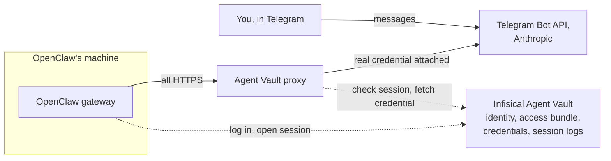

# OpenClaw on Telegram

A personal [OpenClaw](https://docs.openclaw.ai/) assistant that you message on Telegram, running on a DigitalOcean Droplet of its own.

OpenClaw holds no real API keys. [Infisical Agent Vault](https://infisical.com/docs/documentation/platform/agent-vault/overview) attaches each credential to OpenClaw's requests on their way out, and blocks requests to any host outside its access bundle.

## How it works



1. `infisical agent-vault run` logs in as OpenClaw's machine identity, opens a [session](https://infisical.com/docs/documentation/platform/agent-vault/sessions) on the `openclaw` [access bundle](https://infisical.com/docs/documentation/platform/agent-vault/access-bundles), and starts `openclaw gateway run` behind the Agent Vault [proxy](https://infisical.com/docs/documentation/platform/agent-vault/proxies).
2. `agent-vault run` sets `OPENCLAW_PROXY_URL`, so the gateway sends all of its traffic through the proxy, including its Telegram client and the commands OpenClaw runs.
3. The gateway polls Telegram for your messages and sends them to Anthropic. The proxy replaces the Telegram placeholder in each request's URL with the real bot token, and attaches the Anthropic key.
4. If the host is in the access bundle, the proxy attaches the real credential. If it isn't, the proxy returns a 403.

OpenClaw's environment has only placeholders: `ANTHROPIC_API_KEY=agent-vault` and `TELEGRAM_BOT_TOKEN=avplaceholder-openclaw-telegram`.

## What's in this folder

| File | What it does |
| --- | --- |
| `openclaw.json` | OpenClaw's config: the model, and Telegram with an allowlist of who can message it |
| `digitalocean/openclaw-gateway.service` | The systemd service that runs the gateway inside `infisical agent-vault run` |
| `digitalocean/agent-vault-proxy.service` | The systemd service that runs the Agent Vault proxy on `127.0.0.1` |
| `digitalocean/openclaw.env.example` | The template for the gateway's secret file |

The gateway and the proxy run as two systemd services on one Droplet. The gateway needs no inbound port, because it polls Telegram for messages. The steps after [Step 5](#step-5-create-the-droplet) work on any Ubuntu server, such as a Hetzner server or an EC2 instance.

OpenClaw can run commands on its machine. Give the Droplet to OpenClaw alone.

## Agent Vault configuration

**Access bundle:** `openclaw`, with these services:

| Service | Template | Hosts | Credential |
| --- | --- | --- | --- |
| Anthropic | Anthropic | `api.anthropic.com` | An Anthropic API key |
| Telegram | Custom HTTP API | `api.telegram.org` | Pass-through, with a URL path [substitution](https://infisical.com/docs/documentation/platform/agent-vault/http-apis#substitutions) for the bot token |

**Machine identity:** `openclaw`, with the Member role in Agent Vault and access to the `openclaw` access bundle only.

**Proxy:** one proxy with the **Service hosts only** traffic policy.

To give OpenClaw another API, such as GitHub, add a service for it to the access bundle. If OpenClaw refuses to use the API without a key, give it a placeholder in its environment.

The machine identity's client secret is on OpenClaw's machine, so OpenClaw can read it and open more sessions. That's by design. A Member can only open sessions on the access bundles it's granted, so a session OpenClaw opens for itself reaches nothing the first one didn't. Two consequences:

- Grant the identity this one access bundle only, and keep its role at Member
- Revoking OpenClaw's session doesn't stop it, because it can open another one. To stop OpenClaw, revoke the client secret

To limit where a leaked client secret works, restrict it to OpenClaw's machine with [trusted IPs](https://infisical.com/docs/documentation/platform/identities/universal-auth), and give it an expiry.

## What you need

**Accounts:**

- An Infisical organization with Agent Vault, and the Admin role in an Agent Vault project
- A Telegram account
- A DigitalOcean account, with an SSH key added to it

**Credentials.** Each one goes into Agent Vault, never into a file or OpenClaw's environment:

| Credential | Where to get it | Where it goes |
| --- | --- | --- |
| Anthropic API key | The Anthropic Console | The Anthropic service |
| Telegram bot token | [Step 1](#step-1-create-the-telegram-bot) | The Telegram service's substitution |

**Secrets for running OpenClaw.** Each one goes into a secret file on the Droplet, never into git:

| Secret | Where to get it |
| --- | --- |
| Proxy token | The **Proxy Token** dialog, in [Step 2](#step-2-create-the-proxy) |
| Machine identity client ID and client secret | The machine identity, in [Step 4](#step-4-create-the-machine-identity) |

You also need the Agent Vault project's ID and the proxy's fingerprint, which aren't secret. The gateway's secret file holds them, next to the secrets.

## Step 1: Create the Telegram bot

1. In Telegram, message [@BotFather](https://t.me/BotFather), send `/newbot`, and follow the prompts. Copy the bot token it sends you.
2. Find your numeric user ID, for example by messaging [@userinfobot](https://t.me/userinfobot). Only this ID can message OpenClaw, and you add it to OpenClaw's config in [Step 7](#step-7-create-the-openclaw-user).

## Step 2: Create the proxy

1. In Agent Vault, go to **Proxies** and select **Create Proxy**.
2. Enter a **Name**, expand **Advanced Options**, and set **Traffic Policy** to **Service hosts only**. With **Any host**, the proxy forwards requests to hosts outside the access bundle instead of blocking them.
3. Select **Create**, and keep the proxy token from the **Proxy Token** dialog. You can rotate it later from the proxy's menu. Rotating it also changes the proxy's fingerprint, so update the fingerprint on the Droplet.
4. Copy the proxy's fingerprint from the **Certificate Authority** column on the **Proxies** page. The Droplet uses it to check that it's talking to your proxy.

## Step 3: Create the access bundle

1. Go to **Access Bundles** and select **Create Access Bundle**. Name it `openclaw`.
2. Open the access bundle and select **Add Service**. Add the Anthropic service from its template, and paste the API key.

Telegram puts the bot token in the URL of each request, such as `https://api.telegram.org/bot<token>/getUpdates`, so the Telegram service uses a substitution:

1. Add a service with the **Custom HTTP API** template, and enter `api.telegram.org` in **Hosts**.
2. On the **Credential** step, set the credential type to **Pass-through**.
3. Expand **Advanced Options** and select **Add Substitution**. Enter `avplaceholder-openclaw-telegram` in **Replace**, enter the bot token in **With**, and select **URL Path** under **Replace In**.

## Step 4: Create the machine identity

1. Create a [machine identity](https://infisical.com/docs/documentation/platform/identities/machine-identities) named `openclaw` with Universal Auth, and create a client secret for it.
2. In Agent Vault, go to **Access Control** > **Machine Identities** and select **Add Machine Identity**. Select the identity and choose **Member** in **Product Role**.
3. Open the `openclaw` access bundle, select **Manage Access**, and select **Grant Access** next to the identity.

Keep the client ID and client secret. The client secret is the only real secret the Droplet holds.

## Step 5: Create the Droplet

1. In DigitalOcean, select **Create** > **Droplets**.
2. Choose a region, the **Ubuntu 24.04 (LTS) x64** image, and a **Basic** plan with 2 GB of memory. A 1 GB plan works with a swap file, but OpenClaw responds slowly.
3. Under **Authentication**, select your SSH key, then select **Create Droplet**.
4. Go to **Networking** > **Firewalls** and select **Create Firewall**. Keep only the SSH rule under **Inbound Rules**, keep the default **Outbound Rules**, apply the firewall to the Droplet, and select **Create Firewall**.
5. Connect to the Droplet with its IP address:

   ```
   ssh root@<droplet-ip>
   ```

## Step 6: Install OpenClaw

1. If the Droplet has less than 2 GB of memory, add a 2 GB swap file. The gateway uses about 600 MB, and stalls without swap on a 1 GB Droplet:

   ```
   sudo fallocate -l 2G /swapfile
   sudo chmod 600 /swapfile
   sudo mkswap /swapfile
   sudo swapon /swapfile
   echo '/swapfile none swap sw 0 0' | sudo tee -a /etc/fstab
   ```

2. Install Node.js 24, the Infisical CLI, `git`, and OpenClaw:

   ```
   curl -fsSL https://deb.nodesource.com/setup_24.x | sudo bash -
   curl -1sLf 'https://artifacts-cli.infisical.com/setup.deb.sh' | sudo bash
   sudo apt-get install -y nodejs infisical=0.45.13 git
   sudo npm install -g --allow-scripts=openclaw openclaw@2026.11.10
   ```

## Step 7: Create the OpenClaw user

1. Create a user for OpenClaw, clone this repo, and copy the config into the user's home:

   ```
   sudo useradd --create-home --shell /usr/sbin/nologin openclaw
   sudo git clone https://github.com/Infisical/agent-reference-architectures.git /opt/agent-reference-architectures
   cd /opt/agent-reference-architectures/telegram-agents/openclaw
   sudo install -d -o openclaw -g openclaw -m 700 /home/openclaw/.openclaw
   sudo install -o openclaw -g openclaw -m 600 openclaw.json /home/openclaw/.openclaw/openclaw.json
   ```

2. Edit `/home/openclaw/.openclaw/openclaw.json`, and replace `<your-telegram-user-id>` with your user ID from [Step 1](#step-1-create-the-telegram-bot).

   If `nano` or `vim` fails with `Error opening terminal`, the Droplet doesn't know your terminal emulator. Run `export TERM=xterm-256color` and try again.

## Step 8: Create the secret files

1. Create the two files that hold secrets, readable only by root. Replace `<proxy-token>` with the proxy token from [Step 2](#step-2-create-the-proxy):

   ```
   sudo mkdir -p /etc/infisical
   echo 'INFISICAL_AGENT_VAULT_PROXY_TOKEN=<proxy-token>' | sudo tee /etc/infisical/agent-vault-proxy.env
   sudo cp digitalocean/openclaw.env.example /etc/infisical/openclaw.env
   sudo chmod 600 /etc/infisical/*.env
   ```

2. Fill in `/etc/infisical/openclaw.env` with the machine identity's client ID and client secret, the Agent Vault project ID, and the proxy's fingerprint. If you use Infisical outside US Cloud, add `INFISICAL_DOMAIN` to both files.

## Step 9: Start the services

1. Install and start the proxy and the gateway:

   ```
   sudo cp digitalocean/agent-vault-proxy.service digitalocean/openclaw-gateway.service /etc/systemd/system/
   sudo systemctl daemon-reload
   sudo systemctl enable --now agent-vault-proxy openclaw-gateway
   ```

2. Check the gateway's log. The gateway takes about a minute to start, and the log shows `[telegram] [default] starting provider` when it's polling Telegram:

   ```
   journalctl -u openclaw-gateway -f
   ```

3. Message your bot on Telegram. Find it by the username you gave it in [Step 1](#step-1-create-the-telegram-bot), and select **Start**.

## Running OpenClaw

The gateway runs as the `openclaw` user, which can't open the secret files. systemd passes OpenClaw's client secret to its processes as an environment variable, so OpenClaw can read it. That's by design, as [Agent Vault configuration](#agent-vault-configuration) explains. The proxy runs as root, so OpenClaw can't read the proxy token.

OpenClaw keeps its memory and sessions in `/home/openclaw/.openclaw/`, and runs commands with the `openclaw` user's permissions.

To run an `openclaw` command against the gateway, such as `openclaw channels status`, run it as the `openclaw` user:

```
sudo -u openclaw -H openclaw channels status --probe
```

`openclaw-gateway.service` replaces the unit that `openclaw gateway install` creates, because that unit can't start the gateway inside `infisical agent-vault run`. Don't install both.

## Limits

- The proxy can't carry WebSocket connections, so a channel that connects over a WebSocket, such as Discord, doesn't work through Agent Vault. Telegram's Bot API is plain HTTPS
- With a shell, OpenClaw can send requests that skip the proxy. It gets no credentials that way, but it can reach hosts outside the access bundle
